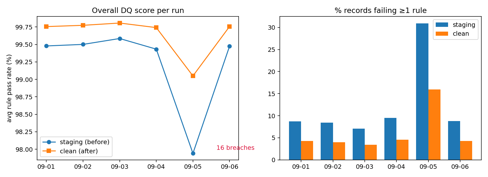

# ✅ Automated Data Quality & Lineage Framework

A config-driven **data-quality, lineage and alerting framework** for a banking-style loan feed.
`raw → staging → quarantine / clean → reporting`, with a rule engine, per-run DQ scorecards, row-level lineage, a reconciliation control, PII masking, breach alerts and a monitoring dashboard.



## Why this exists
Downstream reporting is only as trustworthy as its inputs. This project shows how to **detect, contain, explain and escalate** data defects instead of silently fixing (or ignoring) them:

| Concern | How it is handled |
|---|---|
| Is the data any good? | 19 rules across 5 DQ dimensions (completeness, uniqueness, validity, consistency, timeliness), scored every run |
| Bad rows reaching reports? | Rows failing a **critical** rule go to `quarantine_loans` with the exact failing rule ids; reporting views read `clean_loans` only |
| Did we lose or invent rows? | **Reconciliation control:** raw = clean + quarantined, otherwise a CRITICAL alert |
| Where did this number come from? | `lineage` table: source → transformation → target with row counts for every step of every run |
| Who finds out when it breaks? | Rule breach → console + `logs/alerts.log` + `alerts` table + optional e-mail |
| Privacy | E-mail is SHA-256 hashed before data enters the clean layer |
| Can I add a rule? | Edit `config/dq_rules.yaml`. No code change |

## Results (6 simulated daily batches × 25,000 loans = 150,000 records, 19 rules)

| Run | Multiplier | Quarantined | Defects (any rule): staging → clean | Rule breaches |
|---|---|---|---|---|
| 09-01 | ×1.0 | 2.75% | 8.73% → 4.31% | 0 |
| 09-02 | ×1.0 | 2.66% | 8.41% → 4.02% | 0 |
| 09-03 | ×0.8 | 2.22% | 7.07% → 3.43% | 0 |
| 09-04 | ×1.1 | 2.94% | 9.53% → 4.59% | 0 |
| **09-05** | **×4.0 (incident)** | **10.91%** | **30.92% → 15.98%** | **16 → alerts fired** |
| 09-06 | ×1.0 | 2.62% | 8.79% → 4.28% | 0 |

- **Critical defects reaching the clean layer: 0%** (staging: ≈2.2–2.9% normal days, 10.9% on the incident day).
- The remaining defects after cleaning are *warning-level* (e.g. missing income, stale dates). They are kept and reported rather than deleted. Case issues (`ca` → `CA`) are auto-remediated by standardisation.
- Throughput: a single **500,000-row batch ran end-to-end in ~10 s** on a laptop-class container.
- Sample alert output: [`docs/sample_alerts.log`](docs/sample_alerts.log).

> ⚠️ **Data note:** batches come from `src/generate_loans.py`, which builds Lending-Club-style data and **injects known defects at known rates**. That lets the tests prove the engine finds them, and a ×4 multiplier simulates an upstream incident. To run on the real [Lending Club data](https://www.kaggle.com/datasets/wordsforthewise/lending-club), see "Using real data" below. Numbers will differ, so update the table with your own run.

## Architecture
```
 source CSV ─► raw_loans ─► stg_loans ─► DQ rules (19) ─┬─► quarantine_loans   (critical failures + reasons)
  (all TEXT)    untouched    typed/trimmed   │          └─► clean_loans ─► DQ re-check ─► rpt_* views
                                             │              (standardised, email hashed)
                                             ├─► dq_results   (run × layer × rule)
                                             ├─► alerts       (breaches) ─► log / e-mail
                                             └─► lineage + dq_runs (reconciliation flag)
```
Every data row carries a `run_id`, so any run can be re-inspected or re-run idempotently.

## Quick start
```bash
git clone https://github.com/Adityashukla1019/dq-lineage-framework && cd dq-lineage-framework
python -m venv .venv && source .venv/bin/activate      # Windows: .venv\Scripts\activate
pip install -r requirements.txt
make simulate        # 6 batches incl. one incident (~20 s)  -> data/dq.db + logs/alerts.log
make dashboard       # http://localhost:8501
make test            # 23 tests
```
Without `make`: `python -m src.simulate --batches 6 --rows 25000` then `streamlit run dashboard/app.py`.

Run on a single file: `python -m src.pipeline --csv path/to/file.csv --batch-date 2026-09-01`

## Writing a rule
```yaml
- {id: R020, name: "dti within 0-100", dimension: Validity, column: dti, type: range,
   severity: warning, threshold: 99.5, params: {min: 0, max: 100}}
```
Rule types: `not_null`, `unique`, `range`, `allowed_values`, `regex`, `not_future_date`, `max_age_days`, `cross_field` (pandas expression), `lookup_range`. New types are a 5-line function with the `@check("name")` decorator in `src/dq_engine.py`.

## Dashboard
Scorecard (pass rate vs threshold, by dimension) · Trend (per-rule pass rate over runs) · Before vs After · Lineage graph with row counts · Alerts & quarantine explorer.

## Alerting
Breaches are always logged. To also send e-mail, set `SMTP_HOST`, `ALERT_FROM`, `ALERT_TO` (and optionally `SMTP_PORT`, `SMTP_USER`, `SMTP_PASSWORD`).

## Scheduling
- **GitHub Actions** (`.github/workflows/scheduled_run.yml`): daily cron + manual trigger, uploads `dq.db` and the alert log as artefacts.
- **Apache Airflow** (`dags/dq_pipeline_dag.py`): daily DAG that fails if the source file is missing or reconciliation fails. *Provided but not exercised in this repo's CI; install Airflow and test it locally before claiming it on a CV.*

## Using real data
```bash
python -m src.adapt_lendingclub --src accepted_2007_to_2018Q4.csv --out data/incoming/lc.csv --rows 200000
python -m src.pipeline --csv data/incoming/lc.csv --batch-date 2018-12-31
```
The adapter was unit-tested on a mock frame, not on the multi-GB original. Expect rule R013 (timeliness) to breach on historical dates (raise its `days` or accept it as a finding), and R016 to flag Lending Club's extra status strings.

## Design decisions (interview talking points)
- **Masks, not counts:** each check returns a boolean failure mask so we can quarantine exact rows and explain why.
- **Null policy:** only `not_null` penalises nulls, which avoids double-counting one defect across rules.
- **Severity ≠ threshold:** severity decides what happens to *rows*; threshold decides when to *alert* on a rule.
- **Raw is immutable:** staging only changes types; business-rule problems are surfaced, not hidden.
- **Reconciliation control** protects against silent row loss (the classic ETL bug).
- **DQ score caveat:** the mean pass rate can hide a single failing rule, so breaches are tracked separately (see `docs/metric_definitions.md`).
- **Limits:** SQLite and pandas suit up to a few million rows. Beyond that, push rules into SQL/Spark and use Great Expectations or dbt tests. The design (rules as config, masks, lineage) carries over.

## Docs
[`docs/data_dictionary.md`](docs/data_dictionary.md) · [`docs/metric_definitions.md`](docs/metric_definitions.md)

## Structure
```
config/dq_rules.yaml     rule catalogue (19 rules)      sql/        schema.sql, reporting.sql
src/dq_engine.py         rule engine                    dags/       Airflow DAG
src/pipeline.py          layers, lineage, controls      dashboard/  Streamlit app
src/alerts.py            log + e-mail alerts            tests/      23 pytest tests
src/generate_loans.py    messy-data generator           docs/       dictionary, metrics, charts
src/simulate.py          multi-batch demo
```

## License
MIT
